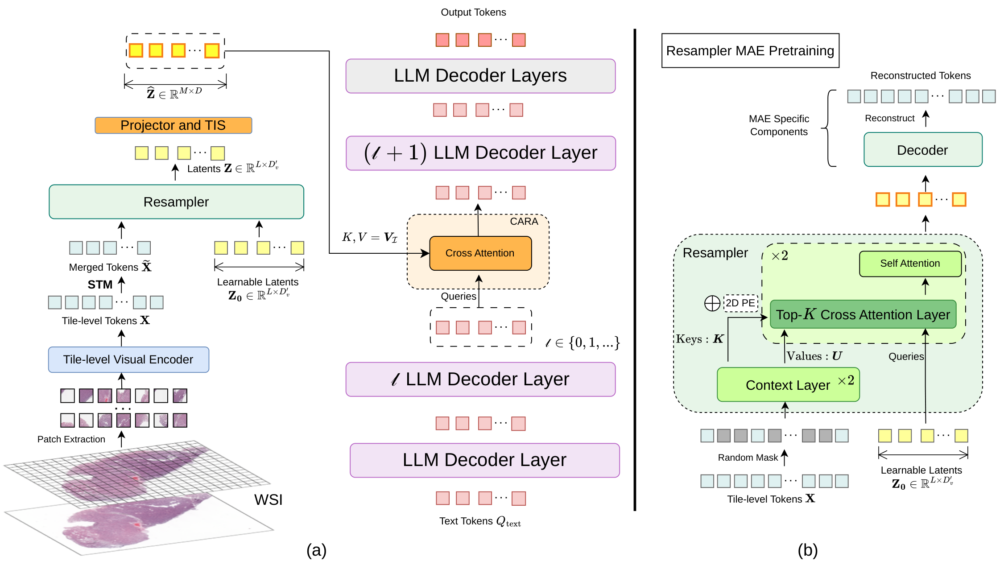

# LoC-Path: Learning to Compress for Pathology Multimodal Large Language Models

[Paper](https://arxiv.org/abs/2512.05391) | [Data](https://huggingface.co/datasets/WinstonHu/LoC-Path-Data)

Official code for training, inference and evaluation of LoC-Path.

## Overview

A whole slide image (WSI) encoded at the tile level gives thousands to tens of thousands of tokens, and many of them are near-duplicates. Slide-level MLLMs such as WSI-LLaVA and SlideChat feed all of these tokens to the LLM as a long visual prefix. LoC-Path compresses the slide first. A Sparse Token Merger (STM) merges neighboring tiles, and an MAE-pretrained resampler compresses the slide into 256 latents. A Token Importance Scorer (TIS) then selects the 96 latents most relevant to the question, and Cross-Attention Routing Adapters (CARA) inject them into LLM layers 1, 3, 5 and 7. The visual tokens never enter the LLM's input sequence.

Compared with prior slide-level MLLMs, this reduces inference TFLOPs by 97% and inference memory by 39%, with competitive results on WSI-Bench, Slide-Bench and Path-Bench.

<p align="center">
  
</p>

(a) LoC-Path pipeline: STM and the resampler compress the tile tokens, then TIS and CARA fuse the selected latents with the LLM through cross-attention. (b) MAE pretraining of the resampler.

## Training cost

All stages train on GPUs with 24 GB of memory. Peak memory per GPU, measured on an RTX 6000 Ada:

| Stage | Trained modules | Batch per GPU × grad. accum. | Peak memory per GPU |
|---|---|---|---|
| MAE resampler pretraining | resampler, MAE decoder | 2 × 4 | 9.2 GB |
| Stage 1 (alignment) | projector, TIS, CARA | 2 × 64 | 12.4 GB |
| Stage 2 (instruction tuning) | the above, plus LLM LoRA and the last resampler layer | 2 × 16 | 16.8 GB |

<details>
<summary><b>Data loading</b></summary>

<br>

In our training runs, reading features from disk was a bigger bottleneck than GPU compute. Features and coordinates are stored as separate `.npy` files and opened with `np.load(..., mmap_mode='r')`, so only the sampled rows are read. When a slide has more tiles than the token budget, the sampler takes evenly spaced rows (`linspace`). Loaders that use `.pt` or `.h5` files read the whole file for every sample.

The collate functions (`collate_feature_tokens` and `slidechat_feature_collate_fn`) pad each batch to its longest slide, up to 61,440 tokens, and pass a `vision_pad_mask` to the visual modules. Text is padded separately. This lets us put 2 slides on each GPU, while slide-level loaders usually handle one at a time.

On our machines, these changes cut Stage 2 training from more than a day to under 20 hours, and made the other stages about 2–3× faster.

</details>

<details>
<summary><b>Memory use by stage</b></summary>

<br>

MAE pretraining does not involve the LLM. The model consists of 2 resampler layers (width 512, 256 latents) and a 2-layer cross-attention decoder that reconstructs tile features rather than pixels. The context encoder uses LongNet dilated attention (segments 1024/2048/4096), whose cost grows about linearly with the number of tiles. Each latent attends only to its Top-K tiles, with K annealed from (128, 64) to (64, 32). 70% of the tiles are masked, and the decoder reconstructs only those. Training runs in bf16.

In Stage 1, Qwen2.5-7B-Instruct is frozen and loaded in 4-bit NF4 with bitsandbytes, so it needs no gradients or optimizer state. The resampler is also frozen, and only the projector, TIS and CARA are trained. The LLM sequence contains text only (at most 2,280 tokens). The visual latents, at most M of them, are seen through cross-attention in 4 layers instead of being appended to the sequence.

Stage 2 adds LoRA (r = 128, α = 64) to all linear layers of the 4-bit LLM. It also unfreezes the last resampler layer, the latent queries and the input projection. The LLM uses FlashAttention-2, and DeepSpeed ZeRO-2 splits gradients and optimizer states across GPUs. The visual input is still reduced to M latents, so memory does not grow with slide size.

</details>

## Installation

We tested on Linux with Python 3.11, PyTorch 2.4.1 (CUDA 12.1) and flash-attn 2.8.3. Dependencies are pinned in `uv.lock` and installed with [uv](https://docs.astral.sh/uv/).

```bash
git clone https://github.com/WinstonHuTiger/loc_path.git
cd loc_path
uv sync --locked                    # creates .venv from uv.lock
# uv sync --locked --extra wandb    # optional: Weights & Biases logging
```

You need an NVIDIA GPU with a driver that supports CUDA 12.1. `uv sync` builds `flash-attn` against the locked PyTorch. If no prebuilt wheel matches, it compiles from source, which needs `nvcc` (set `CUDA_HOME` if necessary) and takes a while. Python 3.12 and later are not supported. Our GPUs were RTX 6000 Ada; we have not tested others.

Every command below can be run with `uv run`, so you do not need to activate `.venv`. The `xtuner` command is installed from this repository.

METEOR, one of the report metrics, needs NLTK's WordNet data:

```bash
uv run python -m nltk.downloader wordnet omw-1.4
```

## Data

### Prepared data

[WinstonHu/LoC-Path-Data](https://huggingface.co/datasets/WinstonHu/LoC-Path-Data) contains the WSI-Bench and BCNB annotations, along with CONCH-v1 tile features and coordinates. The WSI-Bench task splits follow WSI-LLaVA, and we removed annotations whose slides have no features. The dataset card lists the counts and the terms of the source data.

```bash
export LOCPATH_DATA_ROOT=$PWD/data/LoC-Path-Data
uv run --locked python - <<'PY'
import os
from huggingface_hub import snapshot_download

snapshot_download(
    repo_id="WinstonHu/LoC-Path-Data",
    repo_type="dataset",
    revision="v1.0",
    local_dir=os.environ["LOCPATH_DATA_ROOT"],
)
PY

export LOCPATH_FEATURE_ROOT="$LOCPATH_DATA_ROOT/features/conch_v1"
export LOCPATH_STAGE1_REPORT_JSON="$LOCPATH_DATA_ROOT/annotations/train/stage1_reports.json"
export LOCPATH_STAGE1_DATA_PATH="$LOCPATH_STAGE1_REPORT_JSON"
export LOCPATH_STAGE2_DATA_PATH="$LOCPATH_DATA_ROOT/annotations/train/stage2_instructions.json"
```

<details>
<summary><b>Environment variables used by the launchers</b></summary>

<br>

| Variable | Used by | Meaning |
|---|---|---|
| `LOCPATH_FEATURE_ROOT` | all stages | root directory of the tile features (`.npy`) |
| `LOCPATH_UNWANTED_PREFIX_CSV` | all stages (optional) | CSV of slide prefixes to skip |
| `LOCPATH_STAGE1_REPORT_JSON` | MAE pretraining | report JSON that defines the pretraining slides |
| `LOCPATH_RESAMPLER_CKPT` | Stage 1, Stage 2 | MAE-pretrained resampler checkpoint |
| `LOCPATH_STAGE1_DATA_PATH` | Stage 1 | report training JSON |
| `LOCPATH_STAGE2_DATA_PATH` | Stage 2 | VQA training JSON |
| `LOCPATH_STAGE2_PRETRAINED_PTH` | Stage 2 | Stage 1 checkpoint to start from |
| `LOCPATH_LLM_PATH` | training, inference (optional) | local copy of Qwen2.5-7B-Instruct |

</details>

The directory layout, JSON schema and benchmark file names are described in [docs/data_format.md](docs/data_format.md).

<details>
<summary><b>Extracting features from your own slides</b></summary>

<br>

We extracted CONCH-v1 features with one of two pipelines:

| Pipeline | Steps | Settings |
|---|---|---|
| [DSMIL](https://github.com/binli123/dsmil-wsi) | WSI → JPEG tiles → CONCH-v1 features | 224 × 224 tiles at 20×, no overlap, edge-response threshold 15 |
| [TRIDENT](https://github.com/mahmoodlab/TRIDENT) | WSI → tissue segmentation → patch coordinates → CONCH-v1 features | HEST segmentation, 224 × 224 tiles at 20×, no overlap |

For DSMIL we used modified versions of its tiler and of CLAM's feature extraction script, which are not included here. The two pipelines select tissue differently, so process training and test slides with the same one.

Run CONCH v1 with the contrastive projection and output normalization turned off. This gives `[N, 512]` features. For training, store each slide as `*_features.npy` (fp16 or fp32) and `*_coords.npy` (fp32). Coordinates are zero-based tile-grid indices in `(x, y)` order, row-aligned with the features. DSMIL/CLAM writes scaled grid coordinates, while TRIDENT writes level-0 pixel coordinates, so convert them differently.

</details>

## Training

Training has three stages. Each stage has a launcher in `scripts/` and a config in `xtuner/configs/`. First set the GPU layout:

```bash
export NPROC_PER_NODE=4          # GPUs on this node
export NNODES=1 NODE_RANK=0 ADDR=127.0.0.1 PORT=29500
export DEEPSPEED_CFG=$PWD/xtuner/configs/deepspeed/deepspeed_zero2.json   # ZeRO-2, as in the paper
```

On a single GPU, set `NPROC_PER_NODE=1` and leave `DEEPSPEED_CFG` unset. Use `CUDA_VISIBLE_DEVICES` to pick devices. Any extra arguments to a launcher are passed on to `xtuner train`, e.g. `uv run --locked bash scripts/train_stage1.sh --seed 42`.

The global batch size is `NPROC_PER_NODE × NNODES × batch per GPU × accumulative counts`. If you train on a different number of GPUs, change `ACCUMULATIVE_COUNTS` in the config so that the global batch size stays the same.

### Stage 0: MAE resampler pretraining

The resampler is trained to compress tile features into 256 latents by reconstructing masked tiles (mask ratio 70%). Training runs for 100k iterations with AdamW (lr 1e-4, 3% warmup, cosine schedule), and Top-K is annealed from (128, 64) to (64, 32). Two extra losses are used: a coverage loss so that every tile is attended by some latent, and a diversity loss that keeps latents from collapsing onto each other.

```bash
export LOCPATH_FEATURE_ROOT=/path/to/features/conch_v1
export LOCPATH_STAGE1_REPORT_JSON=/path/to/report.json
export WORK_DIR=$PWD/work_dirs/mae_resampler

uv run bash scripts/train_resampler_pretrain.sh
```

Config: `xtuner/configs/mae_pretraining/mae_feature_pretrain_longnet_ctx_encoder.py`

### Stage 1: alignment on reports

The LLM and the resampler are frozen. The projector, TIS and CARA are trained on WSI-Bench reports for 3 epochs (lr 1e-4), and TIS learns from CARA's cross-attention by self-distillation.

```bash
export LOCPATH_FEATURE_ROOT=/path/to/features/conch_v1
export LOCPATH_RESAMPLER_CKPT=/path/to/mae_resampler.pth
export LOCPATH_STAGE1_DATA_PATH=/path/to/stage1_dataset.json
export WORK_DIR=$PWD/work_dirs/stage1

uv run bash scripts/train_stage1.sh
```

Config: `xtuner/configs/vis_adapter/stage_1_vis_adapter_topk_anneal_longnet_ctx_language_add_router_kl.py`

### Stage 2: instruction tuning on VQA

LoRA is added to the LLM, and the last resampler layer, the latent queries and the input projection are unfrozen. The model is trained on all WSI-Bench VQA pairs (lr 2e-5), with an additional pairwise ranking loss for TIS.

```bash
export LOCPATH_FEATURE_ROOT=/path/to/features/conch_v1
export LOCPATH_RESAMPLER_CKPT=/path/to/mae_resampler.pth
export LOCPATH_STAGE2_DATA_PATH=/path/to/stage2_dataset.json
export LOCPATH_STAGE2_PRETRAINED_PTH=/path/to/stage1_checkpoint.pth
export WORK_DIR=$PWD/work_dirs/stage2

uv run bash scripts/train_stage2.sh
```

Config: `xtuner/configs/vis_adapter/stage_2_vis_adapter_topk_anneal_longnet_ctx_language_add_router_kl_mass.py`

`scripts/train_stage1_stage2.sh` runs both stages in sequence. Stage 2 starts from the latest Stage 1 checkpoint and is skipped if Stage 1 fails.

```bash
export STAGE1_WORK_DIR=$PWD/work_dirs/stage1
export STAGE2_WORK_DIR=$PWD/work_dirs/stage2
uv run bash scripts/train_stage1_stage2.sh
```

<details>
<summary><b>Checkpoints and resuming</b></summary>

<br>

A run starts from scratch unless you pass `--resume /path/to/checkpoint`, or `--resume auto` to read `WORK_DIR/last_checkpoint`. Use a new `WORK_DIR` for each experiment.

With DeepSpeed, a checkpoint is a directory whose name ends in `.pth`. Keep the whole directory if you want to resume from it. With ZeRO-1/2, the directory also contains `locpath_model.pth`, which has the LoRA weights and all visual weights, frozen ones included. That file is enough to start Stage 2 or to run inference, and the loader picks it up automatically when given the directory. Older ZeRO checkpoints without this file may lack the frozen visual weights. ZeRO-3 is not supported.

</details>

## Inference

`scripts/test_vis_adapter.sh` runs distributed generation over every `*_test.json` file in a folder and writes one prediction per question.

```bash
export CHECKPOINT=/path/to/stage2_checkpoint.pth
export DATA_DIR=/path/to/benchmark_json_dir      # folder with *_test.json
export FEATURE_ROOT=/path/to/features/conch_v1
export OUT_CSV=$PWD/results/predictions.csv
export OUT_JSONL=$PWD/results/predictions.jsonl
export NPROC_PER_NODE=4

uv run bash scripts/test_vis_adapter.sh --sample_num 61440 --max_new_tokens 512
```

For the released data, read the NPY features instead:

```bash
export DATA_DIR="$LOCPATH_DATA_ROOT/annotations/test/wsi_bench"
export FEATURE_ROOT="$LOCPATH_FEATURE_ROOT"
uv run --locked bash scripts/test_vis_adapter.sh \
  --image_feature_suffix .npy --sample_num 61440 --router-top-m 96
```

For BCNB, set `DATA_DIR=$LOCPATH_DATA_ROOT/annotations/test/external` and run the same command. The BCNB records point to CSV feature files under `FEATURE_ROOT`.

The router schedule is not saved in the checkpoint, so pass `--router-top-m 96` to use the paper's final routing budget. The Stage 2 checkpoint already contains the visual weights, and inference does not need the MAE or Stage 1 checkpoints. It does need the Qwen base model: set `LOCPATH_LLM_PATH` to a local copy, otherwise `Qwen/Qwen2.5-7B-Instruct` is downloaded from Hugging Face.

Other options include `--sample_num` (maximum tiles per slide), `--sample_strategy {linspace,random}` and `--decoding` (greedy by default). Set `CONFIG=...` to use a different config.

## Evaluation

`scripts/evaluate_predictions.sh` scores the prediction JSONL by task: morphological analysis, diagnosis, treatment planning and report generation on WSI-Bench, plus Slide-Bench/BCNB and Path-Bench. Closed-ended questions (multiple choice, true/false) are scored by accuracy. Open-ended questions are scored with WSI-Precision and WSI-Relevance, the LLM-as-judge metrics from WSI-LLaVA. We use their prompts without changes. Report generation is additionally scored with BLEU-1/2, ROUGE-L and METEOR.

The paper uses GPT-4o as the judge, with the API's default sampling settings:

```bash
export OPENAI_API_BASE=https://api.openai.com/v1
export OPENAI_API_KEY=your_api_key

uv run bash scripts/evaluate_predictions.sh \
  --input "$OUT_JSONL" \
  --out-dir "$PWD/results/eval" \
  --provider openai --model gpt-4o \
  --max-workers 4
```

Any OpenAI-compatible server also works, for example a local Qwen3 served with vLLM:

```bash
export OPENAI_API_BASE=http://localhost:8000/v1
export OPENAI_API_KEY=EMPTY

uv run bash scripts/evaluate_predictions.sh \
  --input "$OUT_JSONL" \
  --out-dir "$PWD/results/eval_qwen3" \
  --provider openai-compatible --model <served-model-name> \
  --max-workers 4
```

The output directory contains `results.jsonl`, with one line per item, and `summary.json`, with scores per task and per file. `--report-metric` computes only the report metrics, without calling an LLM. `--report-metric-llm` computes the report metrics and LLM-judge scores for the report rows. `--gt-claims-cache-dir DIR` caches the claims extracted from the ground truth, so they are reused across runs. Also available: `--dry-run`, `--limit N` and `--sample N`.

## Acknowledgements

We thank the authors of the following projects for releasing their code and data.

- [XTuner](https://github.com/InternLM/xtuner): the training framework this code is built on.
- [SlideChat](https://github.com/uni-medical/SlideChat): slide-level pathology MLLM and the Slide-Bench benchmark. Our slide-feature training setup is based on theirs.
- [WSI-LLaVA](https://github.com/XinhengLyu/WSI-LLaVA): the WSI-Bench dataset and the WSI-Precision / WSI-Relevance metrics.
- [MAE](https://github.com/facebookresearch/mae): our resampler pretraining follows its masked-autoencoder approach.

The LongNet code in `xtuner/model/torchscale/` is adapted from [TorchScale](https://github.com/microsoft/torchscale) (MIT License).

## License

Apache License 2.0. See [LICENSE](LICENSE). Third-party attributions are listed in [NOTICE](NOTICE).

## Citation

```bibtex
@misc{hu2026locpathlearningcompresspathology,
      title={LoC-Path: Learning to Compress for Pathology Multimodal Large Language Models},
      author={Qingqiao Hu and Weimin Lyu and Meilong Xu and Kehan Qi and Xiaoling Hu and Saumya Gupta and Jiawei Zhou and Chao Chen},
      year={2026},
      eprint={2512.05391},
      archivePrefix={arXiv},
      primaryClass={cs.CV},
      url={https://arxiv.org/abs/2512.05391},
}
```
